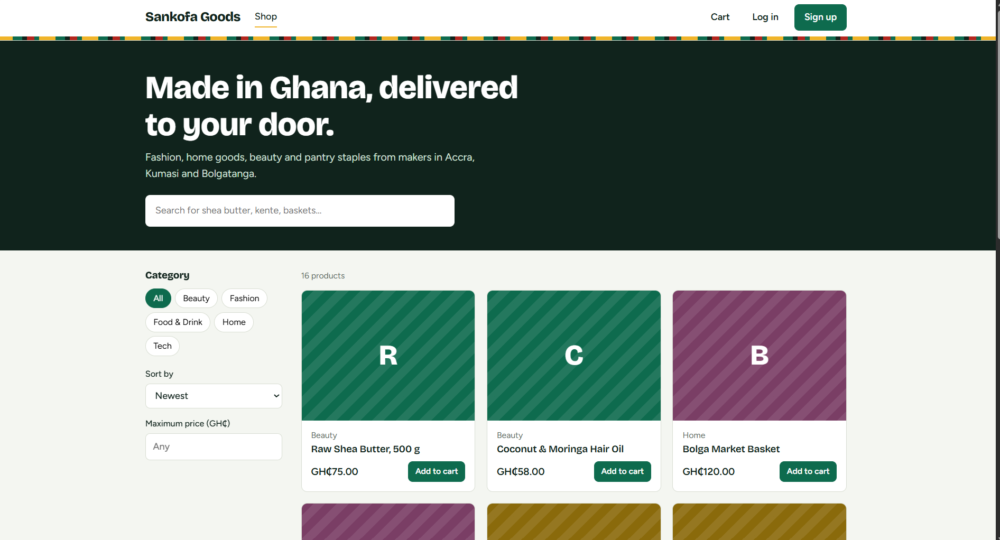
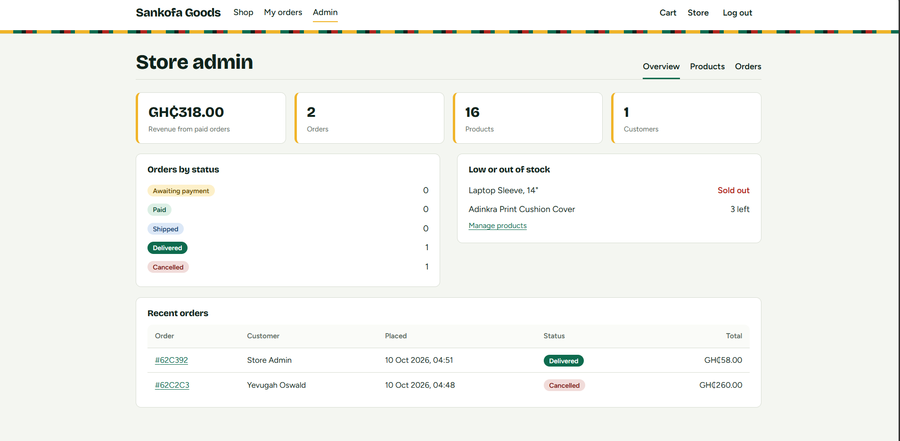
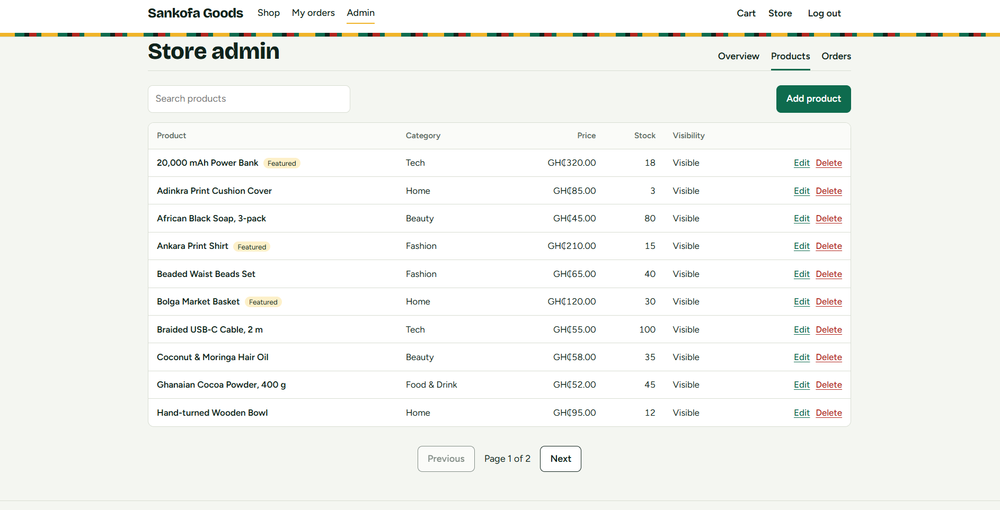
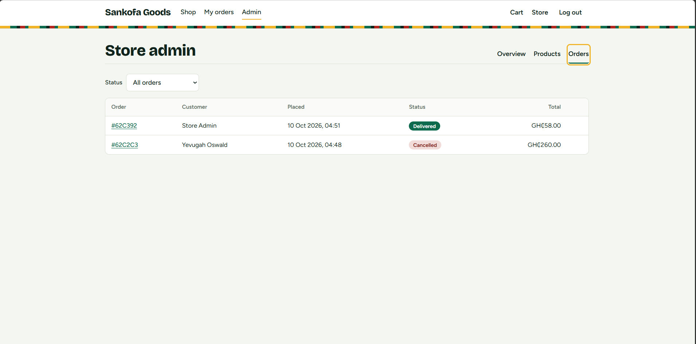

<div align="center">

# Sankofa Goods

**A full-stack e-commerce store for Ghanaian-made products**

Browse, add to cart, check out and track orders. Manage everything from an admin dashboard.




</div>

<!-- After deploying, add a line here:
**Live demo:** https://your-site.vercel.app
-->

## Features

| Customers | Admins |
|---|---|
| Sign up and log in with JWT | Dashboard with revenue, orders, customers and low-stock alerts |
| Search, filter by category and price, sort and paginate | Add, edit, hide and delete products |
| Product pages with live stock status | View all orders and filter by status |
| Cart saved on the server | Move orders through paid, shipped and delivered |
| Checkout with mobile money, card or pay on delivery | Cancel orders (stock returns automatically) |
| Order history, pay (demo) and cancel unpaid orders | Role-protected routes on the server |

## Screenshots

<table>
  <tr>
    <td width="50%"><br><sub><b>Admin dashboard</b></sub></td>
    <td width="50%"><br><sub><b>Product management</b></sub></td>
  </tr>
  <tr>
    <td colspan="2"><br><sub><b>Order management</b></sub></td>
  </tr>
</table>

## Built with

| | |
|---|---|
| **Frontend** | React, React Router, Vite |
| **Backend** | Node.js, Express, Mongoose |
| **Database** | MongoDB |
| **Security** | JWT, bcrypt, Helmet, CORS, rate limiting, input validation |
| **Testing** | Node test runner, 10 integration tests |

## Highlights

- **Server-side security:** every admin route checks the user's role on the server, and sign-up can never create an admin.
- **Trusted prices:** the cart stores only product ids and quantities, and totals are always calculated from the database.
- **No overselling:** stock is reserved atomically at checkout, so two buyers cannot take the last item.
- **Reliable history:** orders keep the price and name from the time of purchase.

## Getting started

You need [Node.js](https://nodejs.org) 18 or newer and a MongoDB database (local or [MongoDB Atlas](https://www.mongodb.com/atlas)).

**1. Start the API**

```bash
cd server
cp .env.example .env        # Windows: copy .env.example .env
```

Open `.env` and set `MONGO_URI` and `JWT_SECRET`. Generate a secret with:

```bash
node -e "console.log(require('crypto').randomBytes(48).toString('hex'))"
```

```bash
npm install
npm run seed                # creates the admin account and 16 sample products
npm run dev                 # runs on http://localhost:5000
```

**2. Start the web app** (in a second terminal)

```bash
cd client
npm install
npm run dev                 # runs on http://localhost:5173
```

**3. Sign in**

Use the `ADMIN_EMAIL` and `ADMIN_PASSWORD` from your `.env` to open the admin dashboard, or create a customer account with **Sign up**.

To run the tests: `cd server && npm test`

## API overview

All routes start with `/api`. Protected routes need an `Authorization: Bearer <token>` header.

| Area | Routes | Access |
|---|---|---|
| Auth | `POST /auth/register`, `POST /auth/login`, `GET /auth/me` | public / user |
| Products | `GET /products`, `GET /products/:id`, `GET /products/categories` | public |
| Product admin | `POST /products`, `PUT /products/:id`, `DELETE /products/:id` | admin |
| Cart | `GET /cart`, `POST /cart/items`, `PATCH` and `DELETE /cart/items/:productId` | user |
| Orders | `POST /orders`, `GET /orders/mine`, `GET /orders/:id`, `POST /orders/:id/pay`, `POST /orders/:id/cancel` | user |
| Order admin | `GET /orders/admin/all`, `GET /orders/admin/stats`, `PATCH /orders/:id/status` | admin |

## Deployment

| Part | Where | Settings |
|---|---|---|
| Database | MongoDB Atlas | Create a cluster and database user |
| API | Render or Railway | Root `server`, start `npm start`, set `MONGO_URI`, `JWT_SECRET`, `CLIENT_ORIGIN`, `NODE_ENV=production` |
| Frontend | Vercel or Netlify | Root `client`, build `npm run build`, output `dist`, set `VITE_API_URL` to your API address ending in `/api` |

## Note on payments

Payment is a demo. The "Pay now" button marks an order as paid without charging anyone. A real gateway such as Paystack or Stripe would replace it.

---

<div align="center">

Built by **Yevugah Oswald** as Project 1 of the Syntecxhub internship.

</div>
